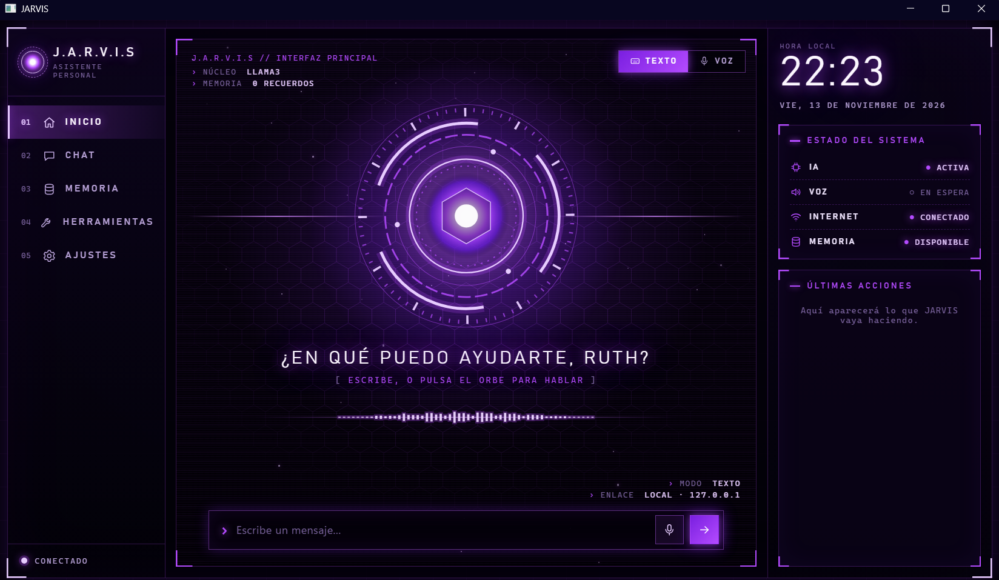

# J.A.R.V.I.S. — asistente personal local

Asistente de escritorio con voz, texto, memoria, personalidad sarcástica y herramientas para
actuar sobre el ordenador. El modelo de lenguaje funciona en local con Ollama.

Parte de una versión anterior de consola (la v4), conserva sus módulos y sus pruebas como red de
regresión, y añade la interfaz HUD morada, la memoria en SQLite, el historial, la voz con Whisper y el
control ampliado del PC. Proyecto personal, pensado como posible TFG de DAM.

## Instalación

Requisitos: Windows 10/11, Python 3.11 y [Ollama](https://ollama.com).

```bash
pip install -r requirements.txt
ollama pull granite4.1:8b
ollama pull nomic-embed-text
```

Los datos que genera (ajustes, base de datos con la memoria y las conversaciones, registros) se guardan
en `data/`, que se crea sola la primera vez y no se sube al repositorio (está en `.gitignore`).

## Cómo se usa

```bash
python jarvis.py
```

Abre la aplicación de escritorio (o doble clic en `Iniciar JARVIS.bat`, que no deja consola abierta).
Para tenerlo como una aplicación más, con el icono del reactor en el escritorio y en el menú Inicio:
`python scripts/crear_acceso_directo.py`. Después se puede anclar a la barra de tareas con clic
derecho → «Anclar a la barra de tareas»; la ventana abierta y el icono anclado son el mismo.
La primera vez pregunta cómo llamarte y cómo quieres proteger las acciones delicadas (confirmación
simple o palabra de seguridad).

| Orden | Qué hace |
| --- | --- |
| `python jarvis.py` | Aplicación de escritorio |
| `python jarvis.py --consola` | Modo consola, como la versión original |
| `python jarvis.py --consola --voz` | Modo consola escuchando el micrófono |
| `python jarvis.py --simular` | Modo demostración: nada se ejecuta de verdad en el PC |
| `python scripts/crear_acceso_directo.py` | Acceso directo con el icono de JARVIS (escritorio y menú Inicio) |
| `python scripts/crear_icono.py` | Vuelve a dibujar el icono (`ui/icono/`) a partir del reactor |
| `python -m pytest tests` | Pruebas |

JARVIS arranca Ollama solo si no está en marcha. Sobre los modelos:

- **granite4.1:8b** es el modelo por defecto porque sabe usar *herramientas* (pedir una búsqueda,
  mirar qué música suena...). llama3 no sabe, y por eso se inventaba datos. Se puede elegir otro en
  Ajustes; conviene que tenga la etiqueta *tools* en Ollama. Comparado con **qwen3:8b** en las mismas
  21 preguntas trampa, qwen3 responde el doble de rápido, pero se inventó algún detalle que granite
  sacó bien de la búsqueda (el rival de España en la final del Mundial 2026), así que granite sigue
  siendo el modelo por defecto. Los dos caben enteros en una gráfica de 8 GB.
- **nomic-embed-text** (opcional) hace que la memoria encuentre los recuerdos por su significado.
- **Contexto de 8192 tokens.** Ollama usa 4096 por defecto y, cuando lo que se le manda no cabe, corta
  por el principio: se perdían las instrucciones (la personalidad y las reglas de honestidad) en cuanto
  la conversación o el texto de la pantalla eran largos. Cuando JARVIS arranca Ollama, activa además la
  atención «flash» y la caché de 8 bits: así granite4.1:8b cabe entero en una gráfica de 8 GB a la misma
  velocidad (medido: 43 tokens/s). Si aun así no cabe todo, JARVIS deja fuera los mensajes más antiguos,
  nunca las instrucciones.
- Al actualizar desde la versión anterior, `data/ajustes.json` se pone al día solo: llama3 pasa a
  granite4.1:8b y la voz de Google a la neuronal de Microsoft. Lo que hubieras elegido a mano se respeta.

- **Ventana:** con PySide6 instalado se usa una ventana nativa; sin él, Microsoft Edge en modo
  aplicación (misma interfaz, sin instalar nada). La ventana nativa dibuja por software, que es lo
  estable en este equipo; la «Aceleración gráfica» de Ajustes usa la tarjeta gráfica, pero con
  Qt 6.12 llegaba a cerrar la ventana de golpe: si eso ocurre, se desactiva sola.
- **Voz (escucha):** Whisper en local. El modelo se descarga la primera vez que se activa el modo voz;
  mientras tanto, o si se prefiere, se puede elegir el reconocedor de Google en Ajustes.
- **Voz (habla):** femenina y natural por defecto, con las voces neuronales de Microsoft (Elvira).
  Si un motor falla, prueba el siguiente: Microsoft → Google → Windows (sin conexión). ElevenLabs
  también se puede usar con clave propia. JARVIS habla de sí misma en el género de la voz elegida.
  Si la voz de Microsoft da un error 403, se arregla actualizando el paquete: `pip install -U edge-tts`.

## Interfaz



HUD futurista en morado neón sobre negro: un reactor de anillos en el centro que gira despacio en
reposo y se acelera al escuchar, pensar o hablar; onda de voz, lecturas técnicas en las esquinas y
paneles con esquinas marcadas. Secciones: Inicio, Chat (con historial), Memoria, Herramientas y
Ajustes.

Para no gastar procesador, el HUD se queda quieto cuando la ventana está minimizada o en segundo
plano con JARVIS en reposo, y vuelve a animarse en cuanto le hablas o vuelves a su ventana.

### Asistente flotante

El reactor del centro, en pequeño y siempre por encima de las demás ventanas (abajo a la derecha la
primera vez), para hablar con JARVIS sin buscar su ventana:

- **Clic:** escucha una frase sin tener que decir «Jarvis». Si está hablando o pensando, la para.
- **Ctrl+Alt+J:** lo mismo desde cualquier programa.
- **Arrastrar:** moverlo; recuerda dónde lo dejas.
- **Clic derecho:** hablar, escribir, detener, abrir la ventana principal, ocultarlo o salir.
- Si la ventana principal no está delante, lo que ha oído y lo que responde salen en un bocadillo
  junto al reactor. Sin micrófono, el clic abre un campo para escribirle.

Se oculta o se vuelve a mostrar en Ajustes → «Asistente flotante». Está dibujado con Qt y no con la
interfaz web, porque siempre está a la vista: gasta un 6-9 % de un núcleo mientras escucha o habla y
nada cuando lleva un rato en reposo (deja de girar hasta que pasa algo).

## Qué sabe hacer

- **Conversar** con personalidad sarcástica (nivel ajustable), en español, con contexto de la
  conversación y de lo que recuerda de ti. Para charlar (saludos, chistes, opiniones, cómo estás) el
  modelo no tiene herramientas: con ellas buscaba en Internet por un «tengo hambre». La «Creatividad»
  de Ajustes se usa en la charla (por encima de 0,8 empieza a inventar); para datos y acciones se usa
  como mucho 0,3.
- **No inventarse las cosas:** cuando le preguntas algo concreto (una persona, un resultado, un
  precio...), el modelo pide una búsqueda y responde con lo que encuentra; si no lo encuentra, lo dice.
  Si preguntas por alguien o algo con nombre propio («¿quién es Nicki Nicole?», «¿de dónde es
  Rosalía?»), JARVIS busca antes de que el modelo conteste, salvo que sea alguien de tus recuerdos.
  Para saber qué música suena lo mira en Windows en vez de suponerlo. Las funciones que puede pedir
  están en `core/funciones.py`. Las preguntas de actualidad (precios, resultados, quién ganó, noticias)
  se buscan siempre antes de contestar, con la pregunta entera.
- **No fingir acciones:** si el modelo dice haber hecho algo que no ha hecho ninguna herramienta
  («mensaje enviado», «guardado», «he abierto…») o pide la palabra de seguridad, se le pide que conteste
  otra vez y, si insiste, la respuesta se sustituye por una corrección honesta.
- **Mandar mensajes por Discord:** «abre Discord y escríbele "Hola" a elPixel12», «dile a Pepe por
  Discord que llego tarde», «¿puedes avisar a Ana en Discord de que ya voy?». Siempre pide confirmación
  (o la palabra de seguridad) diciendo qué se manda y a quién. Antes de escribir comprueba dos cosas: que
  el buscador de Discord (Ctrl+K) está abierto de verdad, con la accesibilidad de Windows, y que se ha
  abierto la conversación de esa persona, por el título de la ventana. Si algo no cuadra, no escribe nada.
  Otras aplicaciones (WhatsApp, Telegram…) todavía no: lo dice en vez de intentarlo.
- **Leer mensajes de Discord:** «¿cuál es el último mensaje que me ha escrito elPixel12 por Discord?»,
  «¿me ha contestado Pepe?», «léeme los últimos 3 mensajes de Ana en Discord», «¿cuál es el último mensaje
  que le he mandado a Pepe?». Abre su conversación (con las mismas comprobaciones que para escribir) y
  lee los mensajes con la accesibilidad de Windows, que da de cada uno quién lo escribió, cuándo y qué
  dice: no confunde lo que te han escrito con lo que has mandado tú. No pide confirmación (solo lee), pero
  Discord los da por leídos al abrir la conversación. Al registro va con quién, nunca lo que dicen.
- **Leer archivos y código:** «¿qué hay en la carpeta C:\…\mi proyecto?», «lee el informe del TFG y
  resúmemelo», «¿en qué archivos se usa session_start?», «busca en mi ordenador el código de mi TFG y dime
  con qué está hecho». La IA puede ver carpetas, leer texto, código, Word, PowerPoint, Excel y PDF, y
  buscar un texto dentro de los archivos. Solo lee, solo dentro de tu carpeta de usuario y nunca lo que
  suele guardar contraseñas (`.env`, claves privadas…), AppData ni los datos de JARVIS.
- **Música:** «pon Bohemian Rhapsody» o «ponme algo de Queen» la busca en YouTube, la abre y comprueba
  que de verdad suena. «¿Qué canción suena?», «pausa», «reanuda», «siguiente» y «anterior» funcionan
  con Spotify, el navegador o cualquier reproductor que aparezca en los controles multimedia de
  Windows. Si eliges Spotify en Ajustes, abre la búsqueda de la canción: Spotify no deja que otra
  aplicación elija qué reproducir.
- **Voz bidireccional:** «Jarvis, abre Spotify». Tras cada respuesta sigue atento unos segundos sin
  repetir su nombre. Se le puede interrumpir diciendo «Jarvis», con el botón de detener o con Esc.
- **Aprende de ti mientras habláis:** si cuentas algo tuyo («vivo en Sevilla», «me encanta el rock»),
  lo guarda sola y te avisa en pantalla de lo que ha aprendido. Todo se puede ver, editar y borrar en
  el panel Memoria. Nunca guarda contraseñas ni datos bancarios. Se desactiva en Ajustes → Privacidad
  («Aprender de lo que hablamos»); entonces pregunta antes de guardar cada dato.
- **Memoria a petición:** «recuerda que…» (también «quiero que recuerdes que…» o «añade a tu memoria
  que…»), «guárdalo en tu memoria» (guarda lo que acabas de contar), «¿qué recuerdas de mí?»,
  «recuérdame cómo se llama mi TFG», «cambia… a…», «olvida que…». La IA también puede guardar un dato
  cuando se lo pides en una frase más larga.
- **Historial** de conversaciones, con búsqueda, y resumen de cada una para recordarla más adelante.
- **Recordatorios, temporizadores, alarmas y agenda:** «pon un temporizador de 10 minutos», «despiértame
  mañana a las 7 y media», «recuérdame el jueves a las 5 ir al dentista», «¿qué tengo hoy?», «cancela la
  alarma», «dame 5 minutos más». Entiende las fechas en español («en una hora y media», «pasado mañana
  por la tarde», «el 24 de diciembre a las 10»). Avisa en voz alta aunque estés en modo texto o con otra
  cosa, y si el ordenador estaba apagado, te lo dice al arrancar. Opcionalmente lee un calendario iCal
  (por ejemplo, la «dirección secreta en formato iCal» de Google Calendar), solo para leer.
- **Resumen de buenos días:** «buenos días» (una vez al día) o «dame el resumen del día»: el tiempo de tu
  ciudad, lo que tienes hoy y tres titulares. Se puede activar para que te lo dé al abrir JARVIS.
- **Leer la pantalla:** «¿qué error es este?», «léeme esto», «tradúceme lo que pone en la pantalla»,
  «resume esto». Saca el texto de la ventana en la que estabas con el reconocimiento de texto que trae
  Windows y se lo pasa al modelo. La captura no se guarda.
- **Buscar y abrir archivos:** «abre el PDF del TFG», «busca la foto de la playa», «¿dónde está el documento
  de inglés?», «abre lo último que he descargado», y luego «abre el segundo». Usa el índice de búsqueda de
  Windows; los programas y scripts nunca se abren desde aquí.
- **Estado del equipo:** «¿cuánta batería me queda?», «¿cómo va el ordenador?» (procesador, memoria,
  disco y gráfica) y el brillo de la pantalla («sube el brillo», «pon el brillo al 40»).
- **Internet:** búsqueda y noticias resumidas, búsqueda en un sitio («busca lo-fi en YouTube»),
  resumen de una página y el tiempo de cualquier ciudad. Las búsquedas van a DuckDuckGo a través de
  Edge sin ventana, con un perfil propio de JARVIS (nunca el tuyo), y las noticias salen de Google
  Noticias. Los resultados que no tienen que ver con lo buscado se descartan, y para personas, lugares o
  conceptos se completa con Wikipedia.
- **Juegos:** abre por su nombre cualquier juego instalado en Steam o Epic Games, aunque no tenga
  acceso directo («quiero jugar a Fall Guys», «vamos a jugar al Rocket League», «abre Phasmophobia»).
  Abrirlos sí; jugar no: JARVIS no ve la pantalla ni mueve el ratón.
- **Control del PC:** abrir cualquier programa instalado, carpetas y webs; cerrar aplicaciones;
  escribir en la ventana activa o en una aplicación; teclas, multimedia y volumen; apagar, reiniciar,
  suspender, bloquear, modo oscuro, captura de pantalla, vaciar la papelera…
- **Secuencias:** «abre el bloc de notas, luego escribe Hola y después pulsa intro».

### Herramientas MCP

[MCP](https://modelcontextprotocol.io) es un estándar abierto para dar herramientas a una IA. JARVIS puede
usar las de servidores MCP locales que configures en `data/mcp.json` (hay un ejemplo en
`docs/mcp.ejemplo.json`). Sin ese fichero no se arranca nada. Por defecto el modelo solo puede usar las
herramientas de solo lectura; las que pueden cambiar cosas hay que permitirlas una a una
(`herramientas_permitidas`) o por servidor (`permitir_cambios`). Cada llamada queda en el registro.

### Desde el móvil

En Ajustes → Móvil se puede abrir una entrada para usar JARVIS desde el navegador del móvil, en tu misma
Wi-Fi (nunca por Internet): solo atiende a direcciones de la red de casa y se entra con un PIN de 6 cifras
que solo se ve en el ordenador (tras 5 fallos se bloquea unos minutos). Se aplica al reiniciar JARVIS; la
primera vez, Windows preguntará si Python puede usar la red privada. Desde el móvil no se puede cambiar
la seguridad ni ver el PIN, y la voz sale por los altavoces del ordenador.

### Palabra de activación dedicada (opcional)

Por defecto JARVIS transcribe con Whisper lo que oye para buscar «Jarvis». Con
[openWakeWord](https://github.com/dscripka/openWakeWord) (`pip install openwakeword`; sus modelos, unos
pocos MB, se descargan la primera vez) solo atiende tras «Hey Jarvis» y gasta mucho menos. Se elige en
Ajustes → Escucha → «Detector de la palabra de activación». Sin el paquete, todo sigue como siempre.

Con el detector, lo más fiable es decir «Hey Jarvis» de un tirón (sin pausa entre las dos palabras),
esperar a que conteste y dar la orden. También vale todo seguido («Hey Jarvis, abre Spotify»), pero el
modelo está entrenado con voces en inglés y, con acento español, así falla más. Interrumpirle mientras
habla también se hace con «Hey Jarvis».

## Seguridad

- Las órdenes salen de lo que dices tú, pasado por el motor de intenciones
  (`tools/intent_engine.py`) y por la capa de seguridad (`tools/security.py`). No se ejecutan
  comandos arbitrarios: solo un catálogo cerrado.
- El modelo de lenguaje solo puede pedir funciones **no delicadas** de una lista cerrada (buscar,
  mirar qué suena, poner o pausar música, abrir un programa). Si pide algo delicado, como abrir
  PowerShell, se rechaza: eso solo se hace con una orden tuya y tu confirmación. Lo que llega de
  Internet es solo texto que el modelo lee.
- Las **acciones delicadas** (cerrar programas, escribir, borrar recuerdos o conversaciones, apagar,
  reiniciar, suspender, vaciar la papelera, abrir herramientas del sistema) esperan confirmación o la
  palabra de seguridad. Caducan a los 45 segundos y admiten tres intentos.
- La palabra de seguridad se guarda como hash con sal; nunca aparece en la conversación, el historial
  ni los registros. Cambiarla o quitarla exige la actual. Si la escribes sin que JARVIS te la pida, no
  se guarda ni le llega a la IA: te avisa. La IA nunca la pide ni la comprueba.
- Mandar un mensaje es siempre una acción delicada; la IA puede prepararlo, pero solo sale si lo
  confirmas. Al registro va a quién y por dónde, nunca lo que dice.
- Cada acción queda en el registro de auditoría `data/logs/acciones.jsonl`.
- La interfaz solo es accesible desde este equipo y con el testigo de sesión de cada arranque.

## Estructura

```
jarvis.py              punto de entrada
core/                  núcleo
  assistant.py           montaje de todas las piezas y política de escucha
  orchestrator.py        entrada → intención → permiso → herramienta o modelo → respuesta
  brain.py               núcleo conversacional (Ollama, personalidad, streaming, funciones)
  funciones.py           funciones que el modelo puede pedir (búsqueda, música, memoria...)
  mcp.py                 cliente MCP: herramientas de servidores locales (data/mcp.json)
  personality.py         estilos y frases con sarcasmo
  history.py             conversaciones, mensajes y resúmenes
  database.py            esquema SQLite (recuerdos, conversaciones, mensajes, consentimientos)
  embeddings.py          vectores de significado (nomic-embed-text) para la memoria
  config.py              ajustes validados (data/ajustes.json) y secretos
  events.py              bus de eventos núcleo → interfaz
tools/                 herramientas
  intent_engine.py       motor de intenciones por patrones
  security.py            acciones delicadas, confirmación, palabra de seguridad, auditoría
  memory.py              memoria a largo plazo
  computer.py            aplicaciones, ventanas, teclado, multimedia y comandos de sistema
  mensajes.py            mandar y leer mensajes de Discord (con comprobaciones antes de escribir)
  recordatorios.py       recordatorios, temporizadores, alarmas, agenda y calendario iCal
  pantalla.py            leer la pantalla (reconocimiento de texto de Windows)
  archivos.py            buscar, abrir y leer archivos, ver carpetas y buscar dentro (solo lectura)
  sistema.py             batería, procesador, memoria, disco, gráfica y brillo
  media.py               música: controles multimedia de Windows y canciones de YouTube
  browser.py             búsqueda (DuckDuckGo con Edge sin ventana, Google Noticias, Wikipedia) y navegación
  weather.py             tiempo (Open-Meteo)
  registry.py            catálogo de herramientas
voice/                 voz
  listener.py            micrófono, detección de voz, Whisper/Google, palabra de activación
  speaker.py             síntesis (Google, ElevenLabs, Edge, Windows) y reproducción interrumpible
  activacion.py          detector opcional de «Hey Jarvis» (openWakeWord)
ui/                    interfaz
  server.py              API local y canal de eventos
  window.py              ventana de escritorio
  overlay.py             asistente flotante (el reactor siempre encima, Ctrl+Alt+J)
  reactor.py             el reactor dibujado con Qt (lo usan el asistente flotante y el icono)
  icono.py, icono/       icono de la aplicación (jarvis.ico y jarvis.png)
  web/                   la interfaz HUD (HTML, CSS, JS)
tests/                 pruebas (las de la v4 más las nuevas)
docs/                  plan técnico, captura de la interfaz y ejemplo de configuración MCP
data/                  se crea sola: base de datos, ajustes, registros (no se versiona)
```

## Limitaciones

- El modelo funciona en local y tiene 8 000 millones de parámetros: mucho menos que ChatGPT o Claude.
  Las búsquedas y las reglas de honestidad reducen mucho lo que se inventa, pero puede seguir
  equivocándose; por eso los datos importantes los da con lo que ha encontrado y no de memoria.
- Un modelo así no se «entrena» en un ordenador personal hasta ese nivel. Lo que lo hace más útil es
  un modelo mejor, las herramientas y la memoria de lo que le cuentas.
- El calendario iCal es de solo lectura, y de los eventos que se repiten solo se tiene en cuenta la
  primera fecha.
- Google no deja buscar a los programas (pide JavaScript o un captcha): por eso se usa DuckDuckGo a
  través de Edge, que tarda unos 2-4 segundos por búsqueda. Si Edge no está, se usa el buscador de
  respaldo (Bing), que da resultados peores.
- Mandar mensajes depende de cómo sea Discord por dentro (el atajo Ctrl+K y el título de la ventana): si
  Discord cambia, puede dejar de funcionar, pero entonces no escribe nada.

## Recuperar los recuerdos de la versión antigua

La primera versión guardaba la memoria en ChromaDB (`Proyecto_JARVIS/jarvis_db`). Para traerlos:

```bash
python scripts/importar_recuerdos_chroma.py "..\Proyecto_JARVIS\jarvis_db"
```

## Licencia

Código abierto con licencia MIT: ver [LICENSE](LICENSE).
